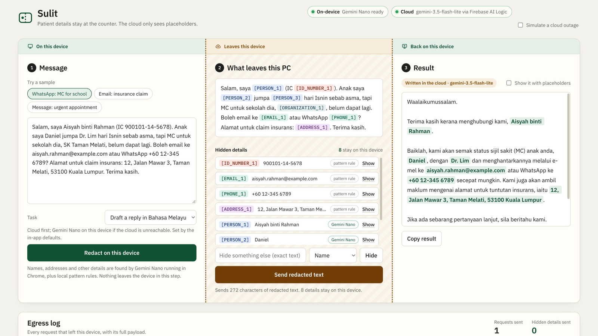
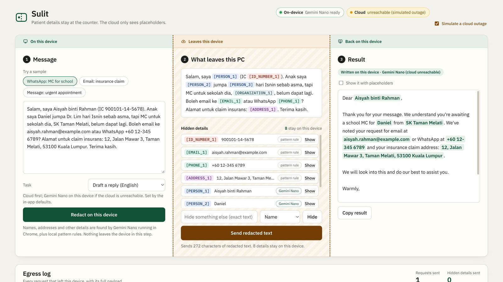
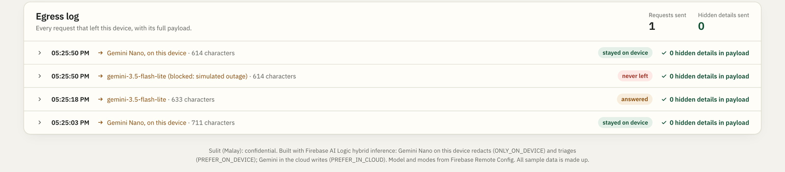

# Sulit

**Patient details stay at the counter. The cloud only sees placeholders.**

*Sulit* is Malay for "confidential". It is a web app for clinic front desks in Malaysia: Gemini Nano, running in Chrome on the front-desk PC, finds and hides every personal detail in a patient's message; Gemini in the cloud drafts the reply (in English or Bahasa Melayu) on placeholders only; the real details are put back on the PC. Built on **Firebase AI Logic hybrid inference**.



- **Measured:** on 138 synthetic Malaysian messages with 645 labelled personal values, pattern rules alone hide 55.8% of them; with Gemini Nano on the device, **99.4%** (4 values with some part left in the payload). On 30 hand-written messages kept out of tuning, **95.7%**. Median **2.2 s** per message on the device. **0** `generateContent` requests during 168 on-device redactions. [Full results](bench/RESULTS.md).
- **Three inference modes, each chosen by what the model is allowed to see:** raw text → `ONLY_ON_DEVICE`; a quick triage of the redacted text → `PREFER_ON_DEVICE`; writing on the redacted text → `PREFER_IN_CLOUD`, which falls back to Gemini Nano when the cloud is unreachable (shown working with the built-in outage switch).
- **An SDK behaviour we found and guard against:** `ONLY_ON_DEVICE` sends the prompt to the cloud when the browser has no `LanguageModel` API. See below.

## Found while building: `ONLY_ON_DEVICE` can still go to the cloud

In the Firebase JS SDK (`firebase` 13.4.0, `firebase/ai`), `getGenerativeModel()` only creates the on-device adapter when `window.LanguageModel` exists. In a browser without Chrome's Prompt API (Firefox, Safari, Chromium builds without it), a model created with `InferenceMode.ONLY_ON_DEVICE` has no adapter, and the request goes to the cloud model, with the full prompt, and comes back with `inferenceSource: "in_cloud"`. When the API exists but the model is unavailable, the same call throws as documented.

For a redaction step, that means the raw text you meant to keep on the device is sent out. Minimal repro (the SDK's browser build, `fetch` stubbed so nothing is sent):

```js
// node repro/only-on-device.mjs   (npm run repro)
const model = getGenerativeModel(ai, { mode: InferenceMode.ONLY_ON_DEVICE });
await model.generateContent('Find the personal details in: "Aisyah binti Rahman, IC 900101-14-5678"');
```

```
1. ONLY_ON_DEVICE, environment has no LanguageModel API:
  inferenceSource: in_cloud
  requests sent: 1
  to: https://firebasevertexai.googleapis.com/v1beta/projects/repro-project/models/gemini-3.5-flash-lite:generateContent
  body contains the private text: true
2. ONLY_ON_DEVICE, LanguageModel API present but model unavailable:
  threw: api-not-enabled AI: Local LanguageModel API not available in this environment. (AI/api-not-enabled)
  requests sent: 0
```

How Sulit closes it (`src/sulit.ts`):

1. `checkOnDevice()` asks Chrome's `LanguageModel.availability()` itself, and the redaction model is never called unless the answer is `available`.
2. Every redaction result whose `inferenceSource` is not `on_device` is rejected.
3. Without Gemini Nano, only local pattern rules run, the user is warned, and nothing is sent until they confirm.
4. The redaction mode is pinned in code. It is deliberately **not** a Remote Config parameter: a remote switch that could send raw text to the cloud would undo the point.

`tests/sdk-only-on-device.test.mjs` runs the repro, so the test will fail (and this note can go) if a future SDK version changes the behaviour.

## Who it is for

Nurul (a fictional receptionist) runs the front desk of a family clinic in Shah Alam. Patients and their families WhatsApp and email her all day: a mother asking for her son's MC with her MyKad number, phone and home address; a son sending his father's date of birth for an insurance claim. Drafting replies with a cloud chatbot is fast, but pasting those messages in sends every detail to a server the clinic does not control.

Malaysian law treats this data seriously:

- The Personal Data Protection Act 2010 (Act 709) counts information about a person's "physical or mental health or condition" as **sensitive personal data** (section 4), and its Security Principle requires "practical steps" to protect personal data from "unauthorized or accidental access or disclosure" (section 9). [Act 709, PDP Commissioner](https://www.pdp.gov.my/wp-content/uploads/2024/07/UNDANG-UNDANG-MALAYSIA_AKTA_PERLINDUNGAN_DATA_PERIBADI_2010_709_MALAY_AND-ENG_V2022.pdf)
- The Personal Data Protection (Amendment) Act 2024 (Act A1727) puts data processors under the Security Principle, raises the penalty for breaching the data protection principles to up to RM1,000,000 or three years' imprisonment, adds biometric data to sensitive personal data, and requires data controllers to notify the Commissioner of a personal data breach "as soon as practicable" (new section 12B). [Act A1727](https://www.pdp.gov.my/wp-content/uploads/2024/11/Act-A1727.pdf)
- Those provisions came into force in stages: 1 April 2025 for the processor duty and higher penalties, 1 June 2025 for data breach notification and data protection officers. [P.U. (B) 522](https://www.pdp.gov.my/wp-content/uploads/2024/12/PENETAPAN-TARIKH-PERMULAAN-KUAT-KUASA.pdf)
- The Commissioner's Data Breach Notification Guideline asks for notice to the Commissioner within 72 hours, and treats a breach involving sensitive personal data as one likely to cause "significant harm" (so the patients must be told too). [DBN Guideline](https://www.pdp.gov.my/wp-content/uploads/2025/08/GP_DBN_ENG.pdf)

Sulit does not make a clinic compliant and is not legal advice. What it does is keep the identifying details on the front-desk PC while still getting the cloud model's help, and show exactly what left.

## How it works

1. **Redact, on this PC.** Local pattern rules (MyKad, Malaysian phone formats, emails, card and account numbers, dates of birth, street addresses with postcodes, numbers spelled out as words) plus Gemini Nano in Chrome through Firebase AI Logic (`ONLY_ON_DEVICE`, JSON Schema `responseConstraint`) find the personal details. Each becomes a placeholder such as `[PERSON_1]` or `[ID_NUMBER_1]`.
2. **Review what leaves.** The middle panel is exactly the text that would leave. Each hidden detail shows who found it (Gemini Nano, a pattern rule, or you); anything missed can be hidden by hand.
3. **Triage, on this PC.** "Quick triage" (route + urgency) runs with `PREFER_ON_DEVICE` on the redacted text: on Gemini Nano when Chrome has it, so nothing leaves.
4. **Write, in the cloud.** Drafting a reply in English or Bahasa Melayu, a summary or action items runs with `PREFER_IN_CLOUD`: Gemini in the cloud, or Gemini Nano if the cloud is unreachable. Only the redacted text is sent; a final check refuses to send if any hidden value is still in the payload.
5. **Restore, on this PC.** Placeholders in the answer are replaced with the real values and highlighted.

An **egress log** lists every request: what left (with the full payload), what stayed on the device, and what an outage stopped.

| Job | Sees | Mode | Why |
|---|---|---|---|
| Redaction | raw message | `ONLY_ON_DEVICE`, pinned in code, plus an availability check | raw text must never leave |
| Quick triage | redacted text | `PREFER_ON_DEVICE` (Remote Config `quick_mode`) | short task, Nano is enough and nothing leaves |
| Writing | redacted text | `PREFER_IN_CLOUD` (Remote Config `writer_mode`) | best writing quality; Nano keeps the desk working offline |

### Cloud outage fallback

Tick **Simulate a cloud outage** (top right). The app then fails this tab's requests to the Gemini endpoints the way a dropped connection does, before anything leaves the browser. Firebase AI Logic sees a network error and falls back to Gemini Nano: the result reads "Written on this device · Gemini Nano (cloud unreachable)" and the egress log shows the cloud attempt as "never left" and the answer as "stayed on device". `npm run check:hybrid` runs the whole sequence in Chrome and prints every request that reached a Gemini endpoint.





### Remote Config

`cloud_model`, `writer_mode` and `quick_mode` come from Firebase Remote Config, with the same values as in-app defaults (`src/settings.ts`, `remoteconfig.template.json`). Malformed values fall back to the defaults; the cloud chip's tooltip says where the values came from. Publish the template with `firebase deploy --only remoteconfig`, or create the three parameters in the console.

## Benchmark

`bench/` holds a seeded generator for **138 synthetic Malaysian messages** (clinic, HR, bank and school; English, Bahasa Melayu and mixed) with **645 labelled personal values**, including adversarial cases: numbers split across a message, digits spelled out in English or Malay, names that are ordinary words (Hope, Joy, May), lowercase names, `at`/`dot` emails, a letter O typed for zero. A second set of **30 hand-written messages (115 values)** was written before any tuning and never used for it. All data is made up.

| | Rules only | Rules + Gemini Nano |
|---|---:|---:|
| Generated set: values hidden, before → after tuning | 25.3% → 55.8% | 96.6% → **99.4%** |
| Generated set: values with any part in the payload | 482 → 285 | 22 → **4** |
| Held-out set: values hidden, before → after | 26.1% → 45.2% | 93.0% → **95.7%** |
| Held-out set: values with any part in the payload | 85 → 63 | 8 → **5** |
| Precision (generated / held-out, after) | 100% / 100% | 96.7% / 94.0% |
| On-device time per message, median / p95 | | 2.16 s / 3.87 s |
| `generateContent` requests during the runs | | 0 |

A value counts as hidden only if every letter and digit of it was replaced. The tuning (Malaysian number formats, name parts, a clean-up of implausible on-device answers, a prompt for Malay and mixed text) was done by reading the misses on the generated set, so its "after" numbers are optimistic; the held-out set is the fairer check. Per-category numbers, adversarial subsets and the remaining misses are in [bench/RESULTS.md](bench/RESULTS.md). Measured in Google Chrome 158 with Gemini Nano, through the app's own `detect()`.

```bash
npm run bench:rules   # rules only, no browser needed
npm run bench         # rules and rules + Gemini Nano (Google Chrome with Gemini Nano in .chrome-profile/)
```

## Run it

Requirements: Node.js 24+.

```bash
npm install
cp .env.example .env      # then fill in your Firebase web config (below)
npm run dev               # http://localhost:5173
```

Without a `.env` the app still runs: redaction, review and the on-device triage work, and the cloud step is turned off with a clear message.

### Firebase setup (free tier)

1. Create a Firebase project in the [Firebase console](https://console.firebase.google.com/) and add a **Web app**.
2. Open **AI Logic** and enable the **Gemini Developer API**.
3. Copy the web app config into `.env` (`VITE_FIREBASE_API_KEY`, `VITE_FIREBASE_PROJECT_ID`, `VITE_FIREBASE_APP_ID`, and the rest).
4. **App Check.** Firebase AI Logic enforces App Check, so cloud requests fail with `401 Firebase App Check token is invalid` until one of these is set up:
   - Local development: put a UUID in `VITE_APPCHECK_DEBUG_TOKEN` and register it under App Check > Apps > your web app > Manage debug tokens. The debug token is only read in development builds and is never bundled into `npm run build`.
   - Hosted: create a reCAPTCHA Enterprise key for your domain, register the web app with it in App Check, and put the site key in `VITE_RECAPTCHA_ENTERPRISE_SITE_KEY`.
5. Optional: publish the Remote Config template (`firebase deploy --only remoteconfig --project <your-project>`).

### Gemini Nano in Chrome

The on-device steps need Google Chrome with the built-in Prompt API and the Gemini Nano model. See the Firebase guide to [hybrid on-device inference on the web](https://firebase.google.com/docs/ai-logic/hybrid-on-device-inference) and Chrome's [built-in AI](https://developer.chrome.com/docs/ai/get-started) hardware requirements. If Chrome reports the model as downloadable, the first press of **Redact on this device** asks Chrome to download it and shows progress.

### Deploy (Firebase Hosting)

`firebase.json` serves `dist/` with security headers. With a reCAPTCHA Enterprise site key in `.env`: `npm run build && firebase deploy --only hosting --project <your-project>`, then restrict the browser API key to the hosting domain. Visitors without Gemini Nano get the rules-only path with the warning and consent step.

### Other commands

```bash
npm test               # unit tests (vitest), including the SDK repro
npm run build          # type-check and production build into dist/
npm run repro          # the ONLY_ON_DEVICE repro
npm run check:hybrid   # Chrome + Gemini Nano: redaction, on-device triage, cloud reply, outage fallback
```

The demo video is made from the real app: `npm run demo:voice` (Kokoro voice-over), `npm run demo:record` (Google Chrome + Gemini Nano, 1600x900 at 2x), `npm run demo:edit` (camera, cursor, callouts, captions, cards, audio at -16 LUFS), `npm run demo:upload` (a copy under 9.5 MB), `npm run demo:thumbnail`.

## Project layout

| Path | What it does |
|---|---|
| `src/sulit.ts` | On-device availability gate, redaction prompt and parsing, tasks, send-and-restore |
| `src/firebase.ts` | Firebase app, App Check, Remote Config, the three hybrid models |
| `src/settings.ts` | Remote Config parameters, defaults and validation |
| `src/rules.ts` | Local pattern rules for Malaysian identifiers |
| `src/redact.ts` | Placeholders, name parts, restore, leak check |
| `src/outage.ts` | The simulated cloud outage switch |
| `src/main.ts`, `index.html`, `src/style.css` | The three-panel UI and egress log |
| `bench/` | Datasets, scorer, runner, results |
| `repro/only-on-device.mjs` | The SDK repro |
| `tests/` | Unit tests |
| `scripts/` | Chrome launcher, hybrid check, demo video pipeline |

## Known limits

- Redaction quality depends on Gemini Nano; the review step is there because no detector is perfect (see the remaining misses in `bench/RESULTS.md`).
- The on-device session is created for English input and output. Bahasa Melayu and mixed messages still go through it (they are part of the benchmark above), and the cloud model writes the Malay replies.
- Placeholders are restored by token name; if the cloud model rewrites a placeholder beyond recognition, that spot stays as written.
- Text only.

## Licence

Apache License 2.0. See `LICENSE`.
